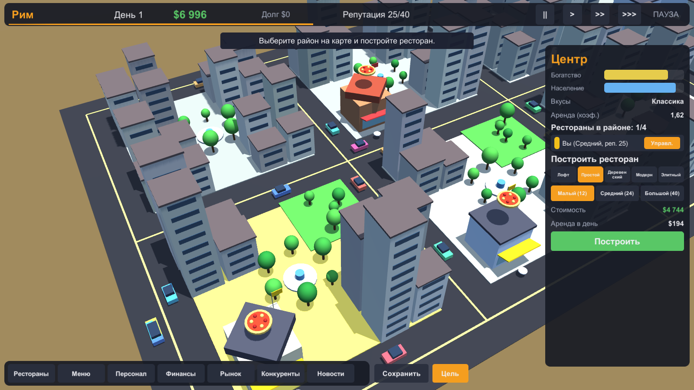

# Pizza Tycoon (Unity 2021.3 LTS)

> Открытая игра в жанре «пиццерийный магнат» на Unity: строй рестораны в десяти городах мира, управляй меню, персоналом и финансами, конкурируй с соперниками. Весь код и все ассеты написаны с нуля. Лицензия MIT, см. [CONTRIBUTING.md](CONTRIBUTING.md).

Современная 3D-графика (URP). Все ассеты процедурные: ни одного файла из сторонних игр.

## Запуск
1. Установите Unity Hub и Editor 2021.3.8f1 (или любой 2021.3 LTS).
2. Unity Hub -> Add -> выберите папку `PizzaTycoon`.
3. При первом открытии сцена `Assets/Scenes/Main.unity` создаётся автоматически (меню Pizza -> Create Scene).
4. Нажмите Play. Сборка: меню Pizza -> Build Windows.

## Управление
WASD/стрелки — камера, Q/E — поворот, колесо — масштаб, ПКМ — вращение (+Shift — сдвиг), Пробел — пауза, 1–3 — скорость, Esc — меню.

## Содержание
- 10 городов (Рим, Париж, Лондон, Берлин, Мадрид, Москва, Нью-Йорк, Рио, Сидней, Токио), цели по репутации и капиталу
- Районы с богатством, населением, вкусами; аренда и спрос
- Постройка/расширение ресторанов (5 стилей, 3 размера), 3D-здания, день/ночь, трафик
- Меню: 10 рецептов, конструктор своих пицц, цены, поставщики
- Персонал, обучение, реклама, кредиты, рынок ингредиентов, события
- Три ИИ-конкурента, новости, сохранения (слот 1 + автосейв)

## Проверено
Собрано в Unity 6000.6.5f1 (Windows x64): `Build/PizzaTycoon.exe`. UI-тест `-uitest` нажимает реальные кнопки (меню, выбор города, постройка, все вкладки, скорость, победа, банкротство, сохранение/загрузка, Esc): 175 кликов, 0 ошибок. Самотест `-selftest` прогоняет все 10 городов, все вкладки, 120 дней симуляции и сохранение/загрузку (0 ошибок). `-autostart` сразу запускает партию в Риме.
Бот-тест `-playtest`: бот играет полные партии обычными действиями игрока. Победа в 9 из 10 городов за 117–360 дней, банкротство наступает на 46-й день при заведомо убыточной игре.
Графика: URP (bloom, ACES, виньетка, цветокоррекция, мягкие тени, SMAA). Пайплайн создаётся автоматически при сборке (Pizza -> Build Windows).
Сборка из консоли: `Unity.exe -batchmode -quit -projectPath . -executeMethod PizzaTycoon.Editor.ProjectSetup.BuildWindows`

## Механики
Подробное исследование источников и правил — в [docs/MECHANICS.md](docs/MECHANICS.md). Реализовано:
- **8 групп клиентов** (богачи, яппи, студенты, дети, подростки, рабочие, туристы, готы). У каждой свой вкус, ожидаемый уровень цен и любимые стили интерьера; в каждом районе своя доля групп.
- **Оценка ресторана** группой = (меню + интерьер + персонал) / 3. Вкладка «Клиенты» показывает разбор по каждой группе.
- **Гурманские звёзды** (до 2) выдаёт мэр по мнению богачей; звёзды повышают привлекательность и могут быть отобраны.
- **Штаб** (4 уровня): лимит ресторанов, охрана (ур. 2), саботаж (ур. 3), поджоги (ур. 4).
- **Персонал:** повара, обслуживающие, менеджер, охрана, смены (2 или 3), оплата и мотивация, здоровье, обучение на смене и вне смены.
- **Интерьер:** стиль, отделка, растения, состояние мебели, реставрация. **Реклама:** ресторан и весь город, целевая группа, обещание (ложное наказывается). **Доставка.**
- **Мэр:** взятки, решения мэра меняют районы. Санинспекция, рэкетиры, склад, лояльность поставщика, мода на ингредиенты.
- **Саботаж** (крысы, санинспекция, налёт полиции, головорезы, поджог) с риском разоблачения; ИИ-соперники тоже саботируют.
- **Задачи городов:** рестораны, репутация, капитал, звёзды, уровень штаба, обойти лучшего конкурента.
- **Экзотические ингредиенты:** муравьи, змея, кенгуру, саранча, личинки (помечены «*» в конструкторе пиццы). Готы и подростки оценивают такие блюда выше, богачи и дети ниже; при экзотике в меню санинспекция проверяет чаще. Есть готовые рецепты: «Змеиная», «Муравьиная», «Австралийская», «Хруст».
